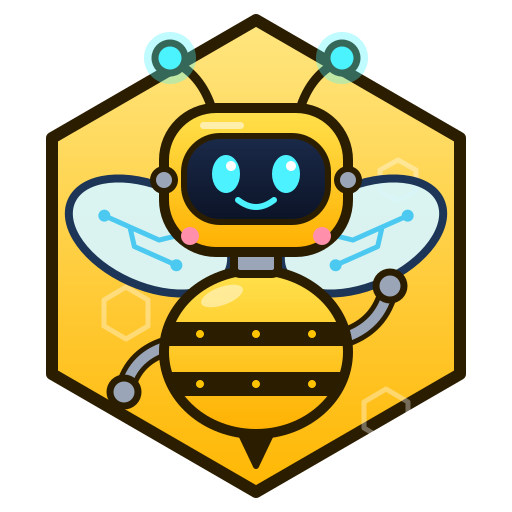
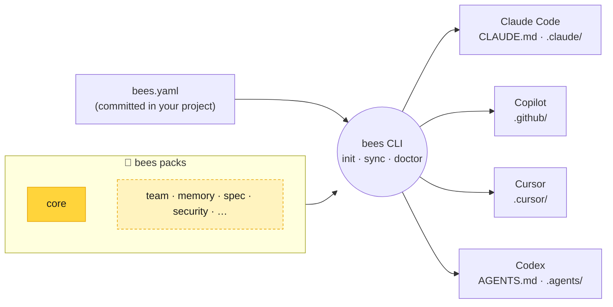

<div align="center">



# bees

<h3>One hive, every agent.</h3>

**Give every teammate the same AI setup (skills, agents, rules and guardrails) in Claude Code, GitHub Copilot, Cursor and Codex, from one committed file.**

[](https://github.com/nciross/bees-agentic-template/actions/workflows/ci.yml)
[](https://www.npmjs.com/package/bees-agentic)
[](LICENSE)
[](#-contributing)


[Quick start](#-quick-start) · [Why bees](#-why-bees) · [Commands](#-commands) · [Packs](#-packs) · [Configuration](#%EF%B8%8F-configuration) · [Team & CI](#-share-it-with-your-team) · [The hive](#-meet-the-hive) · [Token budgets](#-token-budgets) · [What's coming](#-whats-coming) · [Roadmap](#-roadmap)

</div>

> [!NOTE]
> **Early preview (`0.1.0-alpha`).** The CLI, `bees tokens`, and the `core` and `team` packs work today in all four tools. The other packs (memory, Spec Kit, security, the software factory) are being built one pull request at a time. Each section below says whether a feature is ✅ available now or 🚧 planned.

---

## 🚀 Quick start

You need **Node.js 22+**. Your project can be in any language.

```bash
cd your-project
npx bees-agentic@alpha init     # detects your stack, asks which tools and packs
git status                      # review what bees generated
git add -A && git commit -m "chore: add bees agentic dev environment"
```

Not sure yet? Preview first. `--dry-run` lists every file bees would create or change and writes nothing:

```bash
npx bees-agentic@alpha init --dry-run
```

> [!WARNING]
> The npm package is **`bees-agentic`**. The name `bees` on npm belongs to an unrelated project, so never run `npx bees`. Once bees is installed, the command is `bees`.

For a permanent `bees` command, run `npm install -g bees-agentic@alpha`. Every install option (global, dev dependency, from source, CI) is in **[docs/install.md](docs/install.md)**.

### What you get

For a Node/TypeScript project with all four tools selected, `bees init` writes:

```text
bees.yaml                                 ← your config: commit it
bees.lock                                 ← hashes of generated files
AGENTS.md                                 ← shared rules every tool reads (managed region)
CLAUDE.md                                 ← imports AGENTS.md; your own text is kept
.claude/settings.json                     ← permission rules merged in, your settings kept
.claude/skills/project-context/SKILL.md
.claude/commands/onboard.md               ← /onboard
.github/copilot-instructions.md
.github/skills/project-context/SKILL.md
.github/prompts/onboard.prompt.md
.cursor/rules/bees-project-context.mdc
.cursor/skills/project-context/SKILL.md
.cursor/commands/onboard.md
.agents/skills/project-context/SKILL.md   ← Codex
```

Then, in any of the tools, ask for **`/onboard`** to get a tour of the codebase.

## 🍯 Why bees?

Every developer on a team ends up hand-tuning their own AI setup: a different `CLAUDE.md`, a few copied Cursor rules, a half-maintained Copilot prompt folder. The result is a **swarm without a hive**: inconsistent code, duplicated effort, and security rules that only some agents follow.

- 🏠 **One source of truth.** Skills, agents, commands and rules are written once, as portable [Agent Skills](https://agentskills.io) (`SKILL.md`) plus a small `pack.yaml`.
- 🔌 **Drop-in for existing projects.** `bees init` detects your stack and commands. No rewrite, no new framework.
- 🤝 **Every tool, same behaviour.** bees generates each tool's native config, plus a shared `AGENTS.md`.
- 👥 **Team-shareable.** Commit `bees.yaml`, and every teammate gets the same setup.
- ♻️ **Safe re-syncs.** bees only rewrites text between `<!-- bees:begin -->` and `<!-- bees:end -->`, and tracks the files it owns in `bees.lock`. Your own edits stay.
- 🛑 **Never stale.** `bees sync --check` in CI fails when someone forgets to re-sync.

### How it works



1. **Packs** are folders of skills, agents, commands and rules, described by a `pack.yaml`. A pack can `require` other packs.
2. **Your project** lists the tools and packs it wants in `bees.yaml`.
3. **The CLI** renders every pack through a per-tool **adapter** into that tool's native files.
4. **CI** runs `bees sync --check` so the generated files always match `bees.yaml`.

## 🧰 Commands

| Command | What it does |
|---|---|
| `bees init` | Detect the stack, pick tools and packs, write `bees.yaml`, generate configs |
| `bees sync` | Re-generate configs from `bees.yaml`. Safe to run any time; your own edits are kept |
| `bees sync --check` | Write nothing; exit 1 if generated configs are stale. Use it in CI |
| `bees add <pack...>` | Enable packs, plus any packs they require, then sync |
| `bees remove <pack...>` | Disable packs and delete the files they generated. Refuses while another pack needs them |
| `bees list` | List available packs (● = enabled here) |
| `bees tokens` | Show the token cost of your agent setup per tool, against your budgets ([details](#-token-budgets)) |
| `bees doctor` | Check Node.js, `bees.yaml`, `bees.lock`, markers, drift and token budgets |
| `bees help <command>` | Options and examples for one command (same as `bees <command> --help`) |

Handy options:

| Option | Works with | Effect |
|---|---|---|
| `--dry-run` | `init`, `sync`, `add`, `remove` | Show every file that would change, write nothing |
| `-y, --yes` | `init` | No prompts: use the detected tools and the `core` pack |
| `--tools claude,copilot` | `init` | Choose tools: `claude`, `copilot`, `cursor`, `codex` |
| `--packs core` | `init` | Choose packs |
| `--force` | `init` | Start over when `bees.yaml` already exists |
| `--check` | `sync`, `tokens` | Exit 1 when configs are stale (`sync`) or over budget (`tokens`). For CI |
| `--json` | `tokens` | Machine-readable output |
| `-C <dir>` | all | Run as if started in `<dir>` |

Mistype a command or a pack and bees suggests the closest match (`bees snyc` → *Did you mean `bees sync`?*). For a stack trace on an unexpected error, set `BEES_DEBUG=1`.

## 🧩 Packs

| Pack | What you get | Status |
|---|---|:-:|
| 🐝 **core** | Shared `AGENTS.md` conventions, `project-context` skill, `/onboard` command, permission rules that block reading `.env` and `secrets/` | ✅ |
| 👥 **team** | Nine named agents ([meet the hive](#-meet-the-hive)), `/hive`, `/drafts` and `/post` commands, and the `drafts` skill: agents draft, a human posts | ✅ |
| 🐘🐟 **memory** | Elephant (long-term team memory in git) + Goldfish (short-term session notes) | 🚧 |
| 📐 **spec** | Spec-driven development with [GitHub Spec Kit](https://github.com/github/spec-kit), pinned | 🚧 |
| 🛡️ **security** | Secure-coding and STRIDE threat-model skills, dependency audit, secret-blocking hook | 🚧 |
| ✅ **quality** | Code-review agent, `/review`, lint/format after edits | 🚧 |
| 🧪 **testing** | Test-writer agent, TDD workflow skill | 🚧 |
| 🌿 **git-flow** | Branch → conventional commit → PR commands | 🚧 |
| 📚 **docs** | README, ADR and changelog skills | 🚧 |
| 🎨 **design** | Frontend design guidance with [Impeccable](https://github.com/pbakaus/impeccable), pinned | 🚧 |
| 🏭 **factory** | Software factory: issue → spec → plan → build → verify → draft PR, with human approval gates ([ADR 0002](docs/adr/0002-software-factory.md)) | 🚧 |

Third-party packs (Spec Kit, Impeccable) will be installed from their official sources at pinned versions, never copied.

### Supported tools

| | Claude Code | GitHub Copilot | Cursor | Codex |
|---|:-:|:-:|:-:|:-:|
| Shared rules (`AGENTS.md`) | ✅ | ✅ | ✅ | ✅ |
| Skills (`SKILL.md`) | ✅ | ✅ | ✅ | ✅ |
| Commands / prompts | ✅ | ✅ | ✅ | ➖ |
| Sub-agents | ✅ | ✅ | ➖ | ➖ |
| Permission rules | ✅ | ➖ | ➖ | ➖ |

<sub>✅ native · ➖ not available in the tool; bees falls back to rules in `AGENTS.md`, and `bees doctor` tells you.</sub>

## ⚙️ Configuration

This is what `bees init` wrote for the Node project above. Edit it, then run `bees sync`:

```yaml
# bees.yaml — commit this file
version: 1
project:
  name: orders-api
  stack: [Node.js, TypeScript, Express]
  packageManager: pnpm
  commands:          # shown to every agent in AGENTS.md; fix them if detection got one wrong
    install: pnpm install
    dev: pnpm run dev
    build: pnpm run build
    test: pnpm run test
    lint: pnpm run lint
tools: [claude, copilot, cursor, codex]
packs: [core]
```

Optional keys:

```yaml
team:                    # with the team pack: rename agents or switch them off
  reviewer: { name: Ken }
  designer: false
tokens:                  # budgets checked by `bees tokens` and `bees doctor` (defaults shown)
  always-loaded: 3000    # per tool, paid on every request
  skill: 2000
  agent: 1500
  command: 1000
```

🚧 An `overrides:` key (for example extra `block-paths` for the security pack) arrives with its pack.

### Your edits are safe

- **Managed regions** (`AGENTS.md`, `CLAUDE.md`, `.github/copilot-instructions.md`): bees only rewrites the text between the bees markers. Write your own notes above or below them.
- **Owned files** (skills, commands, agents, rules) are fully generated and tracked by hash in `bees.lock`. Don't edit them: change the pack, or write your own file next to them.
- **`.claude/settings.json`**: bees merges its permission rules in and keeps everything else.

## 👥 Share it with your team

1. One person runs `bees init` and opens a pull request with `bees.yaml`, `bees.lock` and the generated files.
2. After merge, every teammate gets the same setup in whichever tool they use. Nothing to install for day-to-day use.
3. Add one step to CI so the generated files never drift from `bees.yaml`:

```yaml
# .github/workflows/ci.yml
- uses: actions/setup-node@v4
  with:
    node-version: 22
- run: npx --yes bees-agentic@alpha sync --check
```

### Try it on a copy of your project first

```bash
git clone https://github.com/nciross/bees-agentic-template && cd bees-agentic-template && npm install
npm run test:real -- ../your-project      # or a git URL
```

This runs bees against a disposable copy and prints a checklist. Your project is never modified. See **[docs/testing.md](docs/testing.md)**.

## 👥 Meet the hive

`bees add team` gives every tool a crew of specialised agents. Each has a name and a role, and writes issues, reviews and PR comments the way a human teammate would: clear, friendly, to the point. In Claude Code and Copilot they are real sub-agents; in Cursor and Codex they are roles listed in `AGENTS.md`.

| | Agent | Role | Typical work |
|---|---|---|---|
| 👑 | **Maya** | Tech Lead | Breaks work into tasks, routes them to the right agent, final go/no-go |
| 🏛️ | **Omar** | Architect | System design, ADRs, trade-off analysis |
| 🛠️ | **Sam** | Developer | Implements features test-first |
| 🎨 | **Lina** | Designer | UI/UX, design tokens, accessibility |
| 🔍 | **Kenji** | Reviewer | Code review with actionable, kind comments |
| 🛡️ | **Aisha** | Security Engineer | Threat models, secure-coding review, dependency audit |
| 🧪 | **Leo** | QA Engineer | Test plans, edge cases, regression checks |
| ✍️ | **Nora** | Writer | Issues, PR descriptions, docs, changelogs |
| 🪙 | **Theo** | Token Optimizer | Reads `bees tokens`, proposes cuts, model routing, note compaction |

| Command | What it does |
|---|---|
| `/hive <task>` | Maya plans the work: goal, size, risks, and ordered tasks with an owner each. She waits for your OK |
| `/drafts` | List agent drafts waiting in `.bees/drafts/` |
| `/post <draft>` | Publish one draft to GitHub with `gh`. Running it *is* your approval |

Rename an agent or switch one off in `bees.yaml` (`team: { reviewer: { name: Ken }, designer: false }`), then run `bees sync`. Every mention of them across the pack follows.

> [!NOTE]
> **Humans stay in control.** Agents *draft* issues, comments, reviews and PR descriptions into `.bees/drafts/` (gitignored); nothing reaches GitHub until a human runs `/post`. Every post ends with a signature such as `— Maya, Tech Lead · bees agent 🐝`, so readers always know an agent wrote it. Agents never merge.

## 🪙 Token budgets

Every rule, agent description and skill list your tools load costs tokens on **every request**. `bees tokens` shows that cost per tool, what loads only on demand, and what to cut:

```text
🪙 Token budget · orders-api   estimates, ~4 characters per token

Always loaded (paid on every request · budget 3,000 per tool)
  Claude Code     ███████████████░░░░░░░░░   1,926   64%  ✔
  GitHub Copilot  ██████████████░░░░░░░░░░   1,803   60%  ✔
  Cursor          ███████████░░░░░░░░░░░░░   1,369   46%  ✔
  Codex           ███████████░░░░░░░░░░░░░   1,369   46%  ✔

  What Claude Code loads
    AGENTS.md (bees)                              1,246
    9 agent descriptions                            358
    2 skill descriptions                            123
    4 command descriptions                          113
    CLAUDE.md (bees)                                 69
    CLAUDE.md (your text)                            17

Loaded on demand (paid only when used)
  skill    drafts           ██░░░░░░░░░░    361 / 2,000  ✔
  agent    token-optimizer  ██░░░░░░░░░░    259 / 1,500  ✔
  …

Tips
  • Ask the token-optimizer agent for a before/after review of the biggest parts.

✔ Everything is within budget. 🍯
```

- It measures the files on disk, so your own text outside the bees markers counts too.
- Set budgets under `tokens:` in `bees.yaml`. `bees doctor` warns when you're over; `bees tokens --check` fails CI; `bees tokens --json` feeds dashboards.
- Counts are estimates (about 4 characters per token). Exact counts vary by model, but the estimate is good enough to compare and budget.

## 🔭 What's coming

### 🐘 Elephant & 🐟 Goldfish: memory that scales

| | 🐘 **Elephant**: never forgets | 🐟 **Goldfish**: forgets on purpose |
|---|---|---|
| **What** | Decisions, conventions, lessons learned, glossary | What happened in *this* session |
| **Where** | `.bees/memory/`, committed and reviewed | `.bees/goldfish/`, gitignored |
| **Lifetime** | Forever (until compacted) | One session → a short handoff note |
| **Token cost** | A tiny index is always loaded; entries are pulled on demand | Near zero: summarized, then dropped |

A goldfish note that keeps coming back gets **promoted** to elephant memory through a normal pull request, so team knowledge grows with review, not by accident.

### 🏭 The software factory

Give bees an issue and get back a reviewed, tested **draft pull request**. The hive works through intake → spec → plan → tasks → build → verify → ship inside your own tool, with a human approving after the spec, after the plan and before anything is posted. bees never merges. The design is in **[ADR 0002](docs/adr/0002-software-factory.md)**.

## 📍 Roadmap

- [x] CLI: `init`, `sync`, `--check`, `add`, `remove`, `list`, `doctor`, `--dry-run` previews
- [x] Adapters: Claude Code, Copilot, Cursor, Codex
- [x] `core` pack and `AGENTS.md` generation
- [x] Pack dependencies (`requires:` in `pack.yaml`)
- [x] Tests: unit, end-to-end fixtures, real-project runner
- [x] First alpha on npm: `bees-agentic@0.1.0-alpha.0`
- [ ] Pack JSON schemas, user/local scopes ([ADR 0001](docs/adr/0001-install-scopes.md)), Claude Code plugin marketplace
- [x] Pack: team, with renames from `bees.yaml` and the draft → `/post` workflow
- [x] `bees tokens`: token budget screen, `--check` for CI
- [ ] Pack: memory
- [ ] Packs: spec (Spec Kit), security, quality, testing, git-flow, docs, design (Impeccable)
- [ ] Pack: factory ([ADR 0002](docs/adr/0002-software-factory.md))
- [ ] **v0.1.0** stable release

## 🤝 Contributing

bees uses **[GitHub flow](https://docs.github.com/en/get-started/using-github/github-flow)**: branch from `main`, commit with [Conventional Commits](https://www.conventionalcommits.org/), open a pull request, and merge once CI passes. `main` is always releasable.

New pack ideas are very welcome. Open a [new pack proposal](https://github.com/nciross/bees-agentic-template/issues/new?template=new_pack.yml). See [CONTRIBUTING.md](CONTRIBUTING.md) for the full guide, [docs/adr/](docs/adr/) for architecture decisions and [docs/releasing.md](docs/releasing.md) for releases.

## 🙏 Credits

bees stands on the shoulders of great open-source work: [Impeccable](https://github.com/pbakaus/impeccable), [GitHub Spec Kit](https://github.com/github/spec-kit) and the [Agent Skills](https://agentskills.io) open standard. Third-party packs are installed from their upstream sources and remain under their own licenses.

## 📄 License

[MIT](LICENSE) © 2026 nciross

<div align="center"><sub>Built by humans and their agents, buzzing together. 🐝</sub></div>
