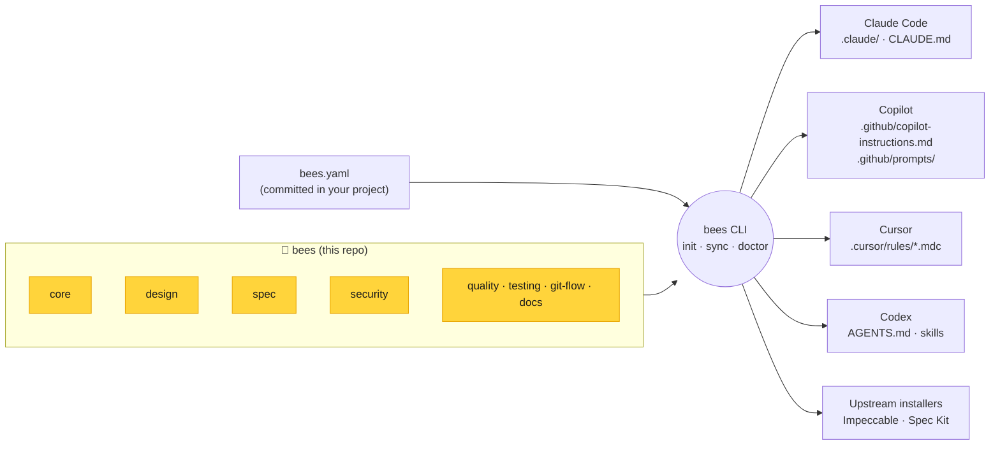

<div align="center">

# 🐝 bees

### One hive, every agent.
**A reusable, team-shareable agentic dev environment — install it into any existing project and every teammate gets the same skills, agents, rules and guardrails, whatever AI tool they use.**

[](LICENSE)
[](#-contributing)
[](#-roadmap)


[Why bees](#-why-bees) · [How it works](#-how-it-works) · [Packs](#-packs) · [Memory](#-elephant---goldfish--memory-that-scales) · [The hive](#-meet-the-hive) · [Quick start](#-quick-start) · [Team sharing](#-share-it-with-your-team) · [Roadmap](#-roadmap)

</div>

> [!NOTE]
> **bees is in early preview.** This README describes the target design; features land pull request by pull request — see the [roadmap](#-roadmap) for what's shipped.

---

## 🍯 Why bees?

Every developer on a team ends up hand-tuning their own AI setup: a different `CLAUDE.md`, a few copied Cursor rules, a half-maintained Copilot prompt folder. The result is a **swarm without a hive** — inconsistent code, duplicated effort, and security rules that only some agents follow.

**bees** fixes that:

- 🏠 **One source of truth** — skills, agents, commands, rules and hooks are written once, as portable [Agent Skills](https://agentskills.io) (`SKILL.md`) plus a small `pack.yaml`.
- 🔌 **Drop-in for existing projects** — `npx bees init` detects your stack and wires everything in. No rewrite, no new framework.
- 🤝 **Every tool, same behaviour** — native configs are generated for **Claude Code, GitHub Copilot, Cursor and Codex**, plus a shared `AGENTS.md`.
- 👥 **Team-shareable by default** — commit `bees.yaml`; teammates are prompted to install the same setup automatically.
- 📌 **Upstream, pinned** — best-in-class community packs (Impeccable, GitHub Spec Kit, security skills) are installed from their official sources at pinned versions — never copied, never drifting.
- ♻️ **Safe re-syncs** — bees only touches content between `<!-- bees:begin -->` / `<!-- bees:end -->` markers. Your own edits are preserved.

## 🧭 How it works



1. **Packs** live in this repo: each one is a folder of `SKILL.md` skills, agents, commands, rules and hooks, described by a `pack.yaml`.
2. **Your project** declares which tools and packs it wants in `bees.yaml`.
3. **The bees CLI** renders every pack through a per-tool **adapter** and calls official upstream installers for third-party packs.
4. **CI** runs `bees sync --check` so generated configs never go stale.

## 🧩 Packs

| Pack | What you get | Source |
|---|---|---|
| 🐝 **core** | Shared `AGENTS.md` conventions, project-context skill, sane permissions | bees |
| 🎨 **design** | Frontend design fluency, anti-generic-UI guidance, design-token rules | [Impeccable](https://github.com/pbakaus/impeccable) (pinned) + bees glue |
| 📐 **spec** | Spec-driven development: constitution → spec → plan → tasks → implement | [GitHub Spec Kit](https://github.com/github/spec-kit) (pinned) + bees glue |
| 🛡️ **security** | Secure-coding & threat-model (STRIDE) skills, dependency audit, secret-blocking hook, `/security-review` | bees + optional pinned upstream security skills |
| ✅ **quality** | Code-review agent, `/review` command, lint/format after every edit | bees |
| 🧪 **testing** | Test-writer agent, TDD workflow skill | bees |
| 🌿 **git-flow** | GitHub flow commands: branch → conventional commit → PR | bees |
| 📚 **docs** | README, ADR and changelog skills | bees |
| 🐘🐟 **memory** | Elephant (long-term team memory in git) + Goldfish (short-term session memory, summarized then forgotten) | bees |
| 👥 **team** | A named crew of agents — tech lead, architect, developer, designer, reviewer, security, QA, writer, token optimizer | bees |

### Supported tools

| | Claude Code | GitHub Copilot | Cursor | Codex |
|---|:-:|:-:|:-:|:-:|
| Shared rules (`AGENTS.md`) | ✅ | ✅ | ✅ | ✅ |
| Skills (`SKILL.md`) | ✅ | ✅ | ✅ | ✅ |
| Commands / prompts | ✅ | ✅ | ✅ | ✅ |
| Sub-agents | ✅ | ✅ | ➖ | ➖ |
| Hooks (guardrails) | ✅ | ➖ | ✅ | ➖ |
| Plugin marketplace | ✅ | ➖ | ➖ | ➖ |

<sub>✅ native · ➖ not available in the tool; bees falls back to rules in `AGENTS.md`.</sub>

## 🐘 Elephant & 🐟 Goldfish — memory that scales

Agents forget everything between sessions — or remember too much and burn tokens. bees splits memory in two:

| | 🐘 **Elephant** — never forgets | 🐟 **Goldfish** — forgets on purpose |
|---|---|---|
| **What** | Decisions, conventions, lessons learned, glossary | What happened in *this* session |
| **Where** | `.bees/memory/` — committed, reviewed, shared with the whole team | `.bees/goldfish/` — gitignored, local |
| **Lifetime** | Forever (until compacted) | One session → a short handoff note |
| **Token cost** | Only a tiny index is always loaded; entries are pulled on demand | Near zero — summarized, then dropped |

A goldfish note that keeps coming back gets **promoted** to elephant memory through a normal pull request — so knowledge grows with review, not by accident.

## 👥 Meet the hive

bees ships a crew of specialised agents. Each has a name and a role, and writes issues, reviews and PR comments **like a human teammate would** — clear, friendly, to the point.

| | Agent | Role | Typical work |
|---|---|---|---|
| 👑 | **Maya** | Tech Lead | Breaks work into tasks, routes them to the right agent, final go/no-go |
| 🏛️ | **Omar** | Architect | System design, ADRs, trade-off analysis |
| 🛠️ | **Sam** | Developer | Implements features test-first |
| 🎨 | **Lina** | Designer | UI/UX with Impeccable, design tokens, accessibility |
| 🔍 | **Kenji** | Reviewer | Code review with actionable, kind comments |
| 🛡️ | **Aisha** | Security Engineer | Threat models, secure-coding review, dependency audit |
| 🧪 | **Leo** | QA Engineer | Test plans, edge cases, regression checks |
| ✍️ | **Nora** | Writer | Issues, PR descriptions, docs, changelogs |
| 🪙 | **Theo** | Token Optimizer | Context budgets, model routing, memory compaction |

Rename them, drop some, or add your own in `bees.yaml`.

> [!NOTE]
> **Humans stay in control.** Agents *draft* issues and comments into `.bees/drafts/`; nothing is posted to GitHub until a human approves. Every post ends with a small signature — `— Maya, Tech Lead · bees agent 🐝` — so readers always know an agent wrote it.

## 🚀 Quick start

> [!IMPORTANT]
> The CLI ships in **v0.1.0**. Until then, track progress in the [roadmap](#-roadmap).

### Option A: any tool, with the CLI

```bash
cd your-existing-project
npx bees init          # pick tools + packs interactively
git add bees.yaml bees.lock AGENTS.md .claude .github .cursor
git commit -m "chore: add bees agentic dev environment"
```

### Option B: Claude Code only, as a plugin marketplace

```text
/plugin marketplace add nciross/bees-agentic-template
/plugin install bees-security@bees
```

### Everyday commands

| Command | What it does |
|---|---|
| `bees init` | Detect stack, choose tools & packs, write `bees.yaml`, generate configs |
| `bees sync` | Re-generate configs (idempotent, preserves your edits) |
| `bees sync --check` | Fail if configs are stale — use it in CI |
| `bees add <pack>` | Add a pack to the project |
| `bees update` | Bump pinned upstream versions |
| `bees doctor` | Diagnose drift and missing upstream tools |

## ⚙️ Configuration

```yaml
# bees.yaml — committed to your project
version: 1
tools: [claude, copilot, cursor, codex]
packs:
  - core
  - design      # Impeccable, pinned
  - spec        # GitHub Spec Kit, pinned
  - security
  - quality
  - testing
  - git-flow
  - docs
  - memory      # 🐘 elephant + 🐟 goldfish
  - team
team:
  tech-lead: { name: Maya }
  designer:  { name: Lina }
  writer:    { name: Nora, post: draft }   # draft → human approves → gh posts
  token-optimizer:
    name: Theo
    budgets: { agents-md: 2000, skill: 1500 }   # tokens
overrides:
  security:
    block-paths: [".env*", "secrets/**"]
```

## 👥 Share it with your team

1. One person runs `npx bees init` and opens a PR.
2. The PR adds `bees.yaml`, `bees.lock` and the generated configs.
3. After merge, every teammate gets the same setup in whichever tool they use — Claude Code users are even prompted to install the bees plugins automatically via the committed `.claude/settings.json`.
4. Need something project-specific? Write it **outside** the bees markers — `bees sync` will never overwrite it.

## 🗺️ Roadmap

- [x] Repository, README & MIT license
- [ ] Repo hygiene: contributing guide, security policy, templates, CI
- [ ] Pack format: JSON schemas, `core` pack, `AGENTS.md` template
- [ ] CLI core: `init`, `sync`, `--check`, Claude Code adapter, plugin marketplace
- [ ] Adapters: Copilot, Cursor, Codex
- [ ] Packs: design (Impeccable), spec (Spec Kit), security
- [ ] Packs: quality, testing, git-flow, docs
- [ ] Pack: memory — 🐘 elephant & 🐟 goldfish
- [ ] Pack: team — named agents, draft → approve → post workflow
- [ ] **v0.1.0** release on npm

## 🤝 Contributing

bees uses **[GitHub flow](https://docs.github.com/en/get-started/using-github/github-flow)**:

1. Branch from `main` (`feat/…`, `fix/…`, `docs/…`, `chore/…`).
2. Commit using [Conventional Commits](https://www.conventionalcommits.org/).
3. Open a pull request — CI must pass before merge.
4. `main` is always releasable.

New pack ideas are very welcome — open an issue describing the workflow it should teach your agents.

## 🙏 Credits

bees stands on the shoulders of great open-source work: [Impeccable](https://github.com/pbakaus/impeccable), [GitHub Spec Kit](https://github.com/github/spec-kit), and the [Agent Skills](https://agentskills.io) open standard. Third-party packs are installed from their upstream sources and remain under their own licenses.

## 📄 License

[MIT](LICENSE) © 2026 nciross

<div align="center"><sub>Built by humans and their agents, buzzing together. 🐝</sub></div>
