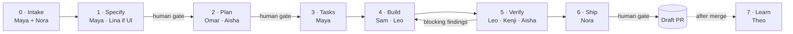

# 0002 — Software factory: an end-to-end, human-gated pipeline

- **Status:** Proposed
- **Date:** 2026-11-21

## Context

bees already plans packs for each step of delivery: **spec** (GitHub Spec Kit), **quality** (review), **testing** (TDD), **security**, **git-flow**, **docs**, **memory** (elephant & goldfish) and **team** (Maya, Omar, Sam, Lina, Kenji, Aisha, Leo, Nora, Theo). Used one by one, they still leave the developer to remember the order, hand context from one step to the next, and decide when an agent may move on.

Teams want to give bees a piece of work, such as an issue or a short description, and get back a reviewed, tested pull request. That should go through the same steps a good human team follows, with a human approving at the moments that matter. That's the **software factory**.

Constraints:

1. **No new runtime.** bees is a config generator. It doesn't call LLM APIs, hold API keys or run a daemon. The work must run inside the tool the developer already uses: Claude Code, Copilot, Cursor or Codex.
2. **Works in all four tools.** It's fine if the experience is reduced where a tool lacks sub-agents or hooks, but the factory must still work.
3. **Humans stay in control.** This repeats the team-pack rule: nothing is posted to GitHub and nothing is merged without human approval.
4. **Token-frugal.** Each stage starts from a small, explicit handoff, not from the whole conversation so far.
5. **Reuse, don't fork.** Spec Kit owns spec → plan → tasks. The factory orchestrates it and doesn't reimplement it.

## Decision

Add a **`factory` pack**. It ships a state machine, written as portable skills, commands and agent instructions. It relies on the other packs for the work in each stage. Pipeline state lives in **plain files in the repo**, so any tool, any teammate and the `bees` CLI can read it.

### Stages



| # | Stage | Owner(s) | Input → Output | Backed by |
|---|---|---|---|---|
| 0 | **Intake** | Maya, Nora | Issue URL or text → `work.yaml` with a goal, size (S/M/L) and the stages it needs | team |
| 1 | **Specify** | Maya (+ Lina for UI work) | Goal → `specs/<id>/spec.md` | spec (Spec Kit `/specify`, `/clarify`) |
| 2 | **Plan** | Omar (+ Aisha: STRIDE pass when the change touches auth, data or I/O boundaries) | Spec → `plan.md`, plus an ADR when a significant decision is made | spec (`/plan`), docs, security |
| 3 | **Tasks** | Maya | Plan → `tasks.md`, small and ordered, each with a test to write first | spec (`/tasks`) |
| 4 | **Build** | Sam (+ Leo writes the test plan) | One task at a time: failing test → code → green → conventional commit | testing, git-flow |
| 5 | **Verify** | Leo, Kenji, Aisha | Full test run, code review, security review → `verify.md`. Blocking findings send the work back to Build | quality, testing, security |
| 6 | **Ship** | Nora | Branch → PR description, changelog entry → a **draft** PR, held in `.bees/drafts/` until a human approves | git-flow, docs, team |
| 7 | **Learn** | Theo | Goldfish notes → proposed elephant memory entries, sent as their own PR | memory |

Small work (size S) skips **Specify** and **Plan** by default. Intake records the skip and its reason in `work.yaml`, so it stays reviewable.

### Gates

A **gate** sits between two stages. It is either `human` (the pipeline stops until someone runs `/factory approve`) or `auto` (the next stage starts as soon as the stage's exit checks pass).

- Defaults: `specify: human`, `plan: human`, `ship: human`. Every other gate is `auto`.
- **`ship` is always `human` and can't be configured otherwise.** Opening a PR, posting a comment and merging stay human actions. bees never merges.
- `/factory rework <stage> "<reason>"` sends the work back to an earlier stage. The reason is recorded and passed to the stage owner.
- Verify ↔ Build loops are capped (`max-rework: 3` by default). When the cap is reached, the pipeline stops and asks a human.

### State: files, not a server

```text
.bees/factory/
  <id>/                     # id = issue number or a short slug, e.g. 42-export-csv
    work.yaml               # stage, owners, gate decisions, rework log, links to artifacts
    handoff.md              # ≤ 300-token goldfish note written at the end of each stage
    verify.md               # test, review and security results
specs/<id>/                 # owned by Spec Kit: spec.md, plan.md, tasks.md
```

- Committed on the work branch, so the whole pipeline history goes through code review and is removed with the branch. (`bees.yaml` can switch this to `local` to keep it gitignored.)
- **Each stage reads only** its own input artifact, the previous `handoff.md` and the elephant index. It never reads the full chat history. That's how context stays fresh and token use stays bounded. Theo's budgets apply per stage.

### Commands (all tools)

One portable command, `/factory`, with sub-commands. It's generated as a Claude Code command, a Copilot prompt, a Cursor command and a Codex skill:

| Command | Does |
|---|---|
| `/factory start <issue-url \| "text">` | Intake: creates the work item and branch, then runs stages until the first human gate |
| `/factory status [id]` | Current stage, owner, open gate, last handoff |
| `/factory next [id]` | Runs the current stage (resumes after a break or a tool switch) |
| `/factory approve [id] [note]` | Passes the open human gate and continues |
| `/factory rework <stage> "<reason>"` | Sends the work back to an earlier stage |
| `/factory stop [id]` | Parks the work item, keeping its state |

On the CLI side, which needs no LLM: `bees factory status` reads `.bees/factory/*/work.yaml`, and `bees doctor` checks that the factory's required packs are installed.

### Configuration

```yaml
# bees.yaml
packs: [core, spec, quality, testing, security, git-flow, docs, memory, team, factory]
factory:
  gates:   { specify: human, plan: human, tasks: auto, build: auto, verify: auto, ship: human }
  skip-for-small: [specify, plan]
  build:   { tdd: true, commit: conventional, max-rework: 3 }
  state:   branch            # branch (committed on the work branch) | local (gitignored)
  intake:  github            # github (gh issue view) | none (text only)
```

`bees init` adds a preset to its pack picker: **🏭 Software factory**. It selects `factory` and every pack it needs in one go.

### Pack dependencies

`pack.yaml` gets a new `requires:` field. `factory` declares `requires: [spec, quality, testing, git-flow, memory, team]`. `security` and `docs` are optional: when present they enrich Plan, Verify and Ship, and when absent those steps are skipped with a note. `bees add factory` offers to add any missing required packs, and `bees remove` refuses to remove a pack that an installed pack requires.

### Tool support

| | Claude Code | Copilot | Cursor | Codex |
|---|:-:|:-:|:-:|:-:|
| `/factory` command | ✅ | ✅ (prompt) | ✅ | ✅ (skill) |
| Stage run by a named sub-agent | ✅ | ✅ | ➖ one agent switches persona per stage | ➖ one agent switches persona per stage |
| Hooks enforce "no push to main" during Build | ✅ | ➖ rule only | ✅ | ➖ rule only |

## Alternatives considered

- **A bees orchestrator runtime** (bees calls LLM APIs and runs the stages itself). Rejected: it ties bees to model providers, needs API keys and billing, duplicates what the four tools already do well, and breaks constraint 1. It may come back later as an optional CI runner.
- **Spec Kit alone.** It covers specify → implement, but has no review, security, ship or learn stages and no human gates. The factory uses it, and doesn't replace it.
- **A GitHub Actions pipeline as the primary runner.** Interesting for unattended runs, but it moves the work away from the developer's editor and makes the human gates slow. Kept as a future runner reading the same `.bees/factory/` state.
- **One mega-prompt per work item.** Simplest to build, but context grows without limit, there are no resumable checkpoints, and gates are hard to audit.

## Consequences

- ✅ Issue → reviewed, tested **draft PR** with a consistent process, whichever tool each teammate uses.
- ✅ The state is plain files, so you can switch tools mid-pipeline, review it in a PR, and inspect it with `bees factory status`.
- ✅ Each stage reuses an existing pack, so the factory stays thin: mostly a skill, a command and a `work.yaml` schema.
- ✅ Bounded context per stage keeps token cost predictable. Theo has a concrete place to enforce budgets.
- ⚠️ It needs `spec`, `quality`, `testing`, `git-flow`, `memory` and `team` to exist first, so the factory comes **last** on the roadmap.
- ⚠️ In Cursor and Codex, a single agent playing every role is weaker than real sub-agents. Gates and `verify.md` matter more there.
- ⚠️ `.bees/factory/` on the work branch adds files to PRs. Reviewers see them, which is intended, and `state: local` is the opt-out.
- ⚠️ `requires:` adds dependency resolution to `add` / `remove` / `sync` and needs tests for cycles and removal order.

## Rollout

1. `pack.yaml` `requires:` field, with resolution in `add` / `remove` / `doctor`.
2. Dependent packs (already on the roadmap): spec, quality, testing, git-flow, memory, team.
3. `factory` pack v0: Intake → Specify → Plan → Tasks → Build → Verify → Ship, with default gates, `work.yaml` schema and `/factory` command.
4. `bees factory status`, `bees init` preset, and an end-to-end fixture test that runs the pipeline's file transitions without an LLM.
5. Learn stage (goldfish → elephant promotion) and an optional GitHub Actions runner.
