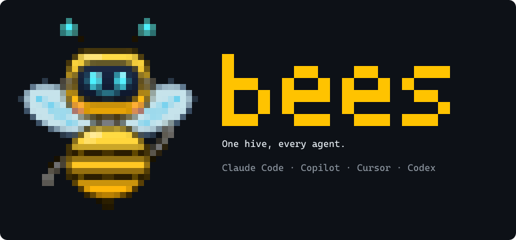

# Brand

bees are bees **and** agent robots: friendly, a little mechanical, always working together.

## Assets

| File | Use |
|---|---|
| [`assets/logo.svg`](../assets/logo.svg) | Main logo: README, docs, plugin listings. Animated; respects reduced motion. |
| [`assets/social-preview.png`](../assets/social-preview.png) | 1280×640 link-preview card (source: `social-preview.svg`). |
| [`assets/cli-banner.ansi`](../assets/cli-banner.ansi) | Banner printed by the `bees` CLI: the logo as true-color pixel art plus a pixel wordmark. Generated by [`scripts/build-cli-logo.mjs`](../scripts/build-cli-logo.mjs). |
| [`assets/cli-banner-plain.txt`](../assets/cli-banner-plain.txt) | Wordmark-only fallback for terminals without color. |

## Palette

| Token | Hex | Used for |
|---|---|---|
| Honey | `#FFC300` | Body, wordmark |
| Hive | `#FFB703` | Badge background |
| Glow | `#4CF2FF` | Eyes, antenna lights, success accents |
| Wing | `#D7F6FF` | Wings |
| Ink | `#2B1D00` | Outlines, stripes |
| Steel | `#9AA5B8` | Arms, neck, bolts |
| Blush | `#FF8FAB` | Cheeks |

## CLI banner

The CLI shows **the same robot bee as the logo**, rendered as true-color pixel art with half-block characters (`▀`), next to a pixel-font `bees` wordmark.



The banner is generated from `assets/logo.svg`, so the two never drift apart. After changing the logo, rebuild it:

```bash
npm i --no-save @resvg/resvg-js
node scripts/build-cli-logo.mjs
```

| Situation | What is shown |
|---|---|
| `bees`, `bees init`, `bees --help` in an interactive terminal | Full color banner |
| Terminal narrower than 76 columns (banner width) | One line: `🐝 bees v0.1.0 — one hive, every agent` |
| `NO_COLOR` set or `--no-color` | Wordmark only (`cli-banner-plain.txt`) |
| Not a TTY, `CI` set, `--quiet` or `--no-banner` | No banner, so logs and pipes stay clean |
| `bees --version` | Version only |
